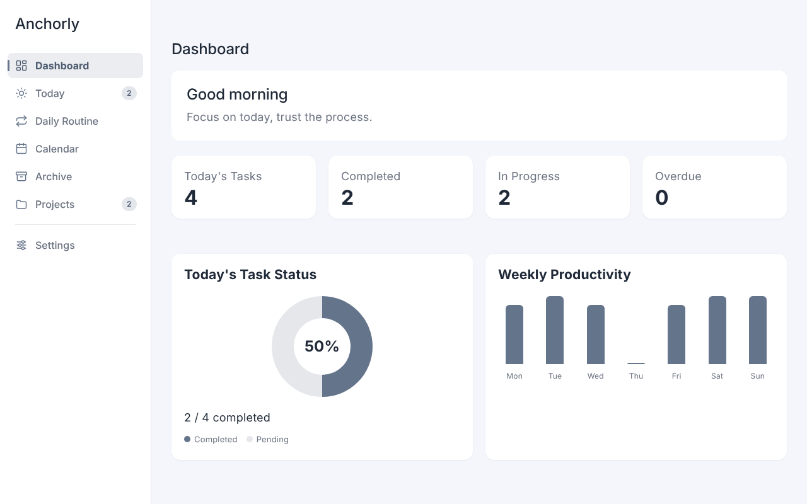
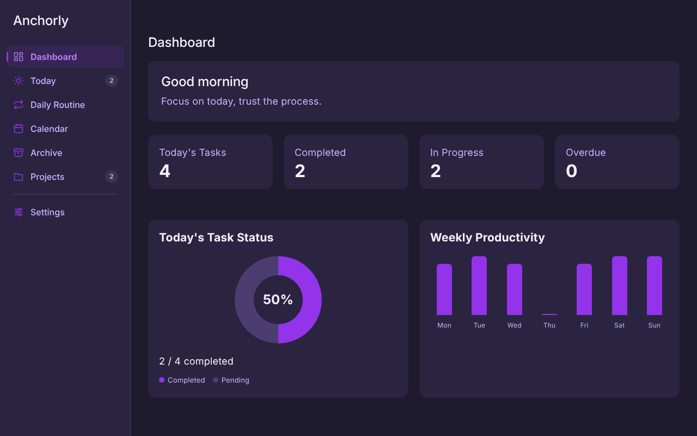
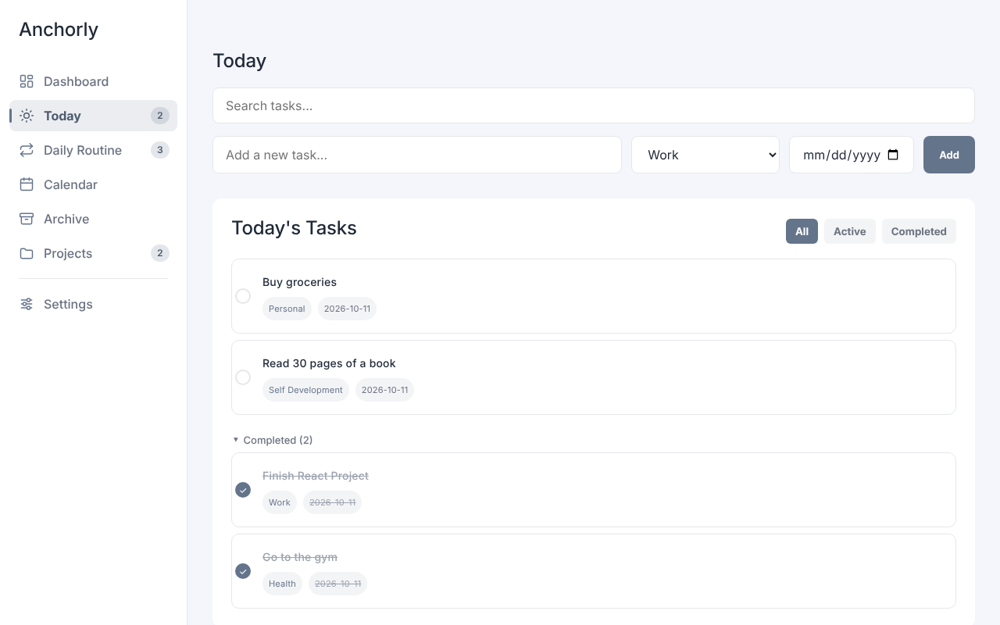
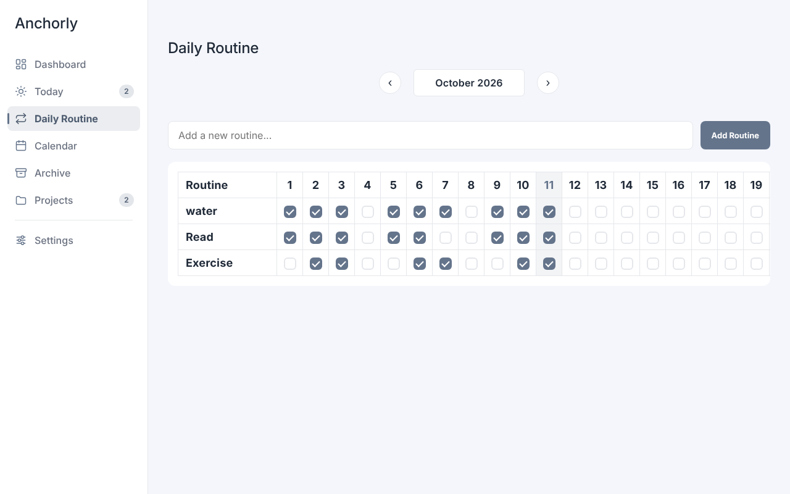
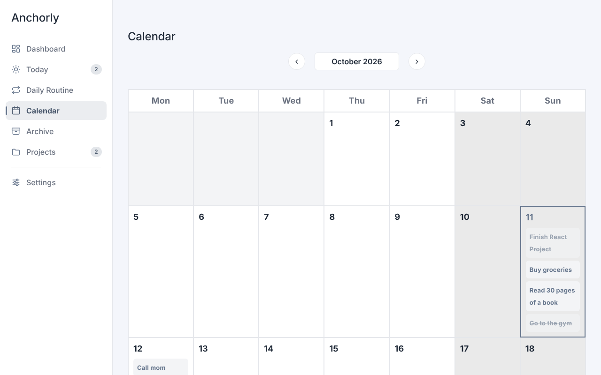

**🌐 Language / Dil:** English | [Türkçe](README.tr.md)

# Anchorly


Anchorly is a task and habit dashboard built with React. Daily tasks, routines, a calendar and projects live in one place, and your data never leaves your browser.

**Live demo:** https://anchorly-nine.vercel.app/

| Dashboard (light theme)                                         | Dashboard (dark theme)                                        |
| --------------------------------------------------------------- | ------------------------------------------------------------- |
|  |  |
| **Today**                                                       | **Daily Routine**                                             |
|                        |           |



---

## Features

- **7 pages:** Dashboard, Today, Daily Routine, Calendar, Archive, Projects and Settings.
- **Dashboard:** greeting, task counters (today, completed, in progress, overdue), a completion donut and a weekly productivity chart.
- **Tasks:** category and date for each task, search, All / Active / Completed filters, and a detail dialog with description, steps and file attachments (up to 1 MB each).
- **Repeating tasks:** daily or weekly. Upcoming occurrences are generated 120 days ahead.
- **Drag and drop:** reorder active tasks by dragging.
- **Daily Routine:** habit tracking in a monthly table with month navigation.
- **Calendar:** month and week views, with quick add on any day.
- **Archive:** browse all your tasks and filter them by status and date range.
- **Projects:** group tasks under a project and manage them from one page.
- **Personalisation:** 6 themes (gray, purple, blue, red, green, pink), Turkish and English, three fonts (Inter, Poppins, Manrope), week starting on Monday or Sunday.
- **Keyboard shortcut:** press `n` outside a text field to jump to Today and focus the new task input.
- **Correct local dates:** "today" follows your local time zone and refreshes itself at midnight.
- **Data safety:**
  - A corrupt value in `localStorage` does not crash the app. It is kept under a `:corrupt` key and the app falls back to defaults.
  - A banner warns you when the browser storage is full or unavailable.
  - Data saved by older versions (numeric ids) is migrated to UUIDs automatically on startup.
- **Demo data:** on the first launch you get a few sample tasks dated relative to today, so the app is never empty.

---

## Tech stack

- React 19
- Vite 8
- Vanilla CSS (no UI library)
- Vitest and Testing Library for tests
- ESLint and Prettier

---

## Getting started

Requires Node.js 22 (22.22.2 or newer recommended).

```bash
git clone https://github.com/berkaycinar-dev/Anchorly.git
cd Anchorly
npm install
npm run dev
```

---

## Scripts

| Command              | What it does                         |
| -------------------- | ------------------------------------ |
| `npm run dev`        | Start the development server         |
| `npm run build`      | Create a production build in `dist/` |
| `npm run preview`    | Serve the production build locally   |
| `npm run lint`       | Run ESLint                           |
| `npm test`           | Run all tests once                   |
| `npm run test:watch` | Run tests in watch mode              |
| `npm run format`     | Format `src/` with Prettier          |

Tests run with the time zone fixed to `Europe/Istanbul`, so date logic is tested around local midnight.

---

## Folder structure

```text
src/
├── components/     AddTaskForm, Header, NavIcon, Sidebar, StatCard,
│                   StorageWarning, TaskDetailModal, TaskList
├── constants/      initialData.js (demo data factory)
├── hooks/          useLocalStorageState, useProjects, useRoutines,
│                   useTasks, useToday
├── lib/            id.js, migrations.js, storageStatus.js
├── pages/          Dashboard, Today, DailyRoutine, Calendar,
│                   Archive, Projects, Settings
├── test/           test setup and fixtures
├── utils/          dateHelpers.js, taskHelpers.js
├── App.jsx         App state and page switching
├── App.css         Styles and the six themes
├── strings.js      Turkish and English texts
└── main.jsx        Entry point, runs data migrations before rendering
```

---

## Known limitations

- Data is stored in the browser (`localStorage`). It is not synced between devices or browsers, and the browser limits its size.
- There is no mobile layout yet. The interface is designed for desktop screens.
- Pages do not have their own URLs yet. The address bar stays the same while you navigate.

---

## Roadmap

- [ ] A URL for every page with React Router
- [ ] Keyboard and screen reader accessibility, toast notifications
- [ ] Continuous integration with GitHub Actions
- [ ] State refactor with Context and reducers
- [ ] Mobile layout
- [ ] Backend, database and authentication for cross-device data

---

## License

This project was built for personal and portfolio purposes.

---

**Developer:** [berkaycinar-dev](https://github.com/berkaycinar-dev)