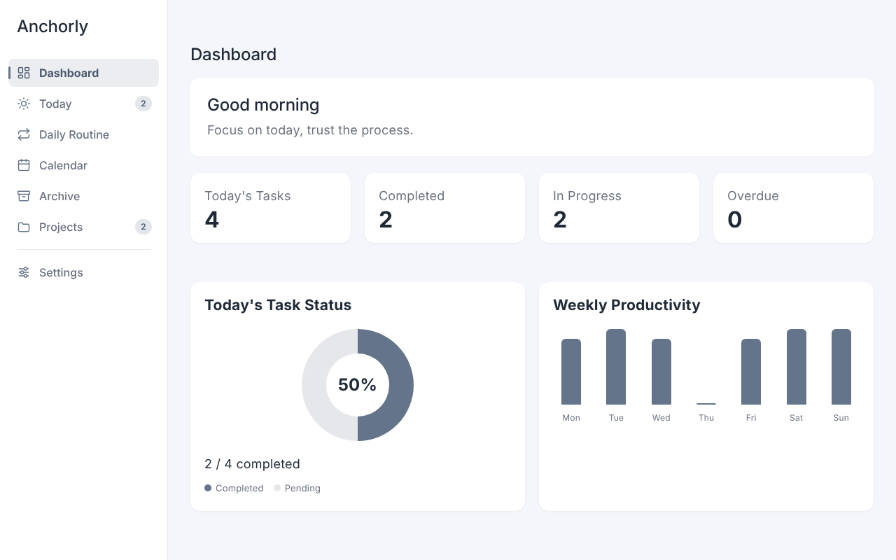
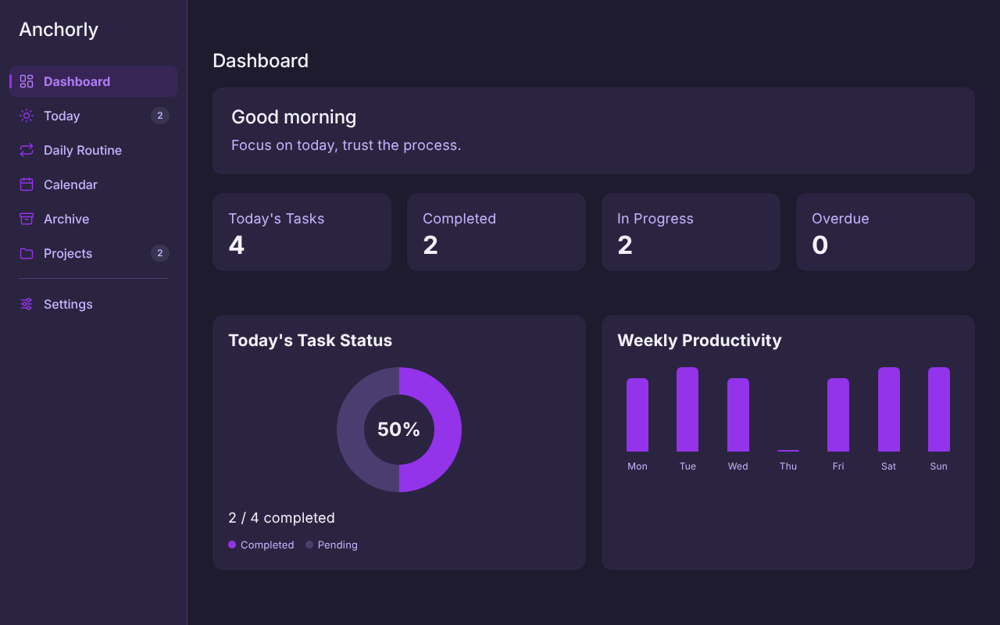
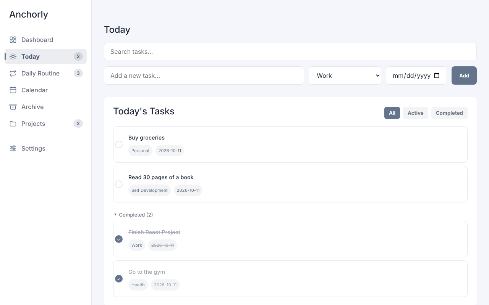
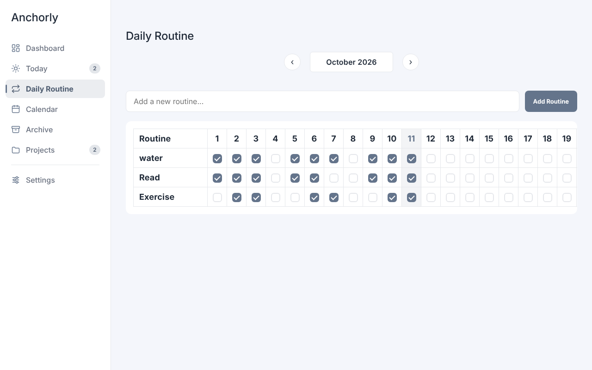
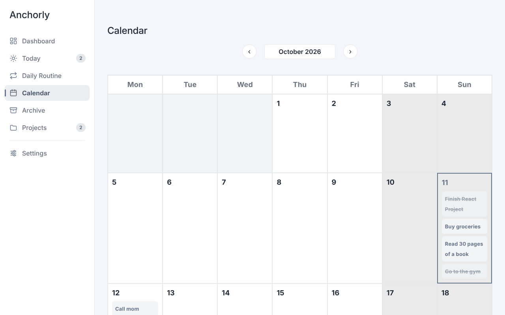

**🌐 Language / Dil:** [English](README.md) | Türkçe

# Anchorly


Anchorly, React ile geliştirdiğim bir görev ve alışkanlık panosu. Günlük görevler, rutinler, takvim ve projeler tek yerde; hesap açmazsan verilerin tarayıcından dışarı çıkmaz. Hesapla kullanırsan veriler sunucuda saklanır ve cihazların arasında seninle gelir.

**Canlı demo:** https://anchorly-app.vercel.app/

| Panel (açık tema)                                          | Panel (koyu tema)                                         |
| ---------------------------------------------------------- | --------------------------------------------------------- |
|  |  |
| **Bugün**                                                  | **Günlük Rutin**                                          |
|                |      |



---

## Özellikler

- **7 sayfa:** Panel, Bugün, Günlük Rutin, Takvim, Arşiv, Projeler ve Ayarlar.
- **Panel:** karşılama mesajı, görev sayaçları (bugün, tamamlanan, devam eden, geciken), tamamlanma halkası ve haftalık verimlilik grafiği.
- **Görevler:** her görev için kategori ve tarih, arama, Tümü / Aktif / Tamamlanan filtreleri; açıklama, adımlar ve dosya eki (her biri en fazla 1 MB) içeren görev detay penceresi.
- **Tekrarlayan görevler:** günlük veya haftalık. Gelecek tekrarlar 120 gün ilerisine kadar üretilir.
- **Sürükle-bırak:** aktif görevlerin sırasını fareyle, dokunmatik ekranda uzun basarak ya da klavyeyle değiştirme.
- **Günlük Rutin:** aylık tabloda alışkanlık takibi, ay ay gezinme. Telefonda gün şeridi ve rutin kartları.
- **Takvim:** ay ve hafta görünümü, herhangi bir güne hızlı görev ekleme. Telefonda gün seçici ve ajanda listesi.
- **Arşiv:** tüm görevlerine göz at; duruma ve tarih aralığına göre filtrele.
- **Projeler:** görevleri bir proje altında toplama ve tek sayfadan yönetme.
- **Duyarlı tasarım:** 375 px telefondan masaüstüne kadar her ekranda çalışır: telefonda alt sekme çubuğu, tablette ikonlu kenar çubuğu, masaüstünde tam kenar çubuğu.
- **Sayfa adresleri:** her sayfanın kendi adresi var; tarayıcının geri tuşu ve yer imleri çalışır.
- **Kişiselleştirme:** 7 tema (gray, purple, blue, red, green, pink, black), Türkçe ve İngilizce, üç yazı tipi (Inter, Poppins, Manrope), haftanın Pazartesi ya da Pazar başlaması.
- **Klavye kısayolu:** yazı alanı dışındayken `n` tuşu Bugün sayfasına gidip yeni görev alanına odaklanır.
- **Doğru yerel tarih:** "bugün" yerel saat diliminize göre belirlenir ve gece yarısı kendiliğinden yenilenir.
- **Veri güvenliği:**
  - `localStorage` içindeki bozuk bir değer uygulamayı çökertmez. Değer `:corrupt` anahtarı altında saklanır ve uygulama varsayılanlara döner.
  - Tarayıcı depolaması dolduğunda ya da kullanılamadığında bir uyarı şeridi gösterilir.
  - Eski sürümlerin kaydettiği veriler (sayısal id'ler) açılışta otomatik olarak UUID'ye dönüştürülür.
- **Demo verisi:** ilk açılışta bugüne göre tarihlenmiş birkaç örnek görev gelir, böylece uygulama boş görünmez.

---

## Kullanılan teknolojiler

- React 19
- Vite 8
- React Router 8
- Sürükle-bırak için dnd-kit
- Vanilla CSS (UI kütüphanesi yok)
- Testler için Vitest ve Testing Library
- ESLint ve Prettier
- GitHub Actions (her push'ta lint, test ve derleme)

---

## Kurulum

Node.js 22 gerektirir (22.22.2 veya üstü önerilir).

```bash
git clone https://github.com/berkaycinar-dev/Anchorly.git
cd Anchorly
npm install
npm run dev
```

### Backend ile çalıştırma (hesaplar, isteğe bağlı)

Hesaplar varsayılan olarak kapalıdır; bayrak açılmadıkça uygulama hiçbir API isteği atmaz ve her şeyi tarayıcıda tutar. Girişi yerelde [anchorly-api](https://github.com/berkaycinar-dev/anchorly-api) ile denemek için:

1. anchorly-api'yi `.env` dosyasında `AUTH_COOKIE_PATH=/api/auth` ile `http://localhost:3000` üzerinde başlat.
2. `.env.example` dosyasını `.env.local` adıyla kopyala ve `VITE_AUTH_ENABLED=true` yap.
3. `npm run dev` çalıştır. Vite `/api/*` isteklerini backend'e iletir (`/api/auth/login` → `/auth/login`); tarayıcı tek bir köken gördüğü için `HttpOnly` refresh cookie'si CORS gerekmeden çalışır.

Access token yalnızca bellekte tutulur. Açılışta oturum yenileme yalnızca bu tarayıcıda daha önce giriş yapılmışsa denenir (`localStorage`'daki `authSessionHint`; içinde token değil yalnızca `"1"` vardır).

---

## Komutlar

| Komut                  | Ne yapar                                  |
| ---------------------- | ----------------------------------------- |
| `npm run dev`          | Geliştirme sunucusunu başlatır            |
| `npm run build`        | `dist/` içinde üretim derlemesi oluşturur |
| `npm run preview`      | Üretim derlemesini yerelde sunar          |
| `npm run lint`         | ESLint çalıştırır                         |
| `npm test`             | Tüm testleri bir kez çalıştırır           |
| `npm run test:watch`   | Testleri izleme modunda çalıştırır        |
| `npm run format`       | Projeyi Prettier ile biçimlendirir        |
| `npm run format:check` | Biçimi değiştirmeden denetler             |

Testler saat dilimi `Europe/Istanbul` olarak sabitlenerek çalışır; böylece tarih mantığı yerel gece yarısı çevresinde test edilir.

---

## Klasör yapısı

```text
src/
├── components/     AddTaskForm, BottomNav, CalendarAgenda, DateField,
│                   Header, Logo, NavIcon, RoutineDayView, Sidebar,
│                   StatCard, StorageToasts, TaskDetailModal, TaskList,
│                   toast/ (ToastProvider)
├── constants/      initialData.js (demo veri), settings.js (temalar, varsayılanlar)
├── auth/           AuthProvider, useAuth, sekmeler arası kanal
├── data/           DataProvider, useRepository, useRepositorySnapshot
│   ├── api/        API istemcisi (token yenileme), auth API çağrıları
│   ├── contracts/  her repository'nin geçmesi gereken sözleşme testleri
│   └── local/      localStorage repository'leri, migration'lar, depolama durumu
├── hooks/          useProjects, useRoutines, useSettings, useTasks,
│                   useToday
├── lib/            id.js
├── pages/          Dashboard, Today, DailyRoutine, Calendar,
│                   Archive, Projects, Settings
├── styles/         tokens.css (yedi tema), base, layout,
│                   components/, pages/
├── test/           test kurulumu ve örnek veriler
├── utils/          categoryHelpers, dateHelpers, routineStats, taskHelpers
├── App.jsx         Uygulama iskeleti, sayfa geçişi, AuthProvider, DataProvider
├── config.js       Özellik bayrakları (VITE_AUTH_ENABLED)
├── routes.js       Sayfa yolları
├── strings.js      Türkçe ve İngilizce metinler
└── main.jsx        Giriş noktası, render öncesi veri göçlerini çalıştırır
```

---

## Bilinen sınırlamalar

- Hesap olmadan veriler tarayıcıda (`localStorage`) saklanır. Cihazlar veya tarayıcılar arasında senkronize olmaz ve tarayıcı boyutunu sınırlar.
- Backend ücretsiz bir barındırma planında çalışır ve 15 dakika istek almazsa uykuya geçer; bu yüzden duraklamadan sonraki ilk istek bir dakikaya kadar sürebilir.
- Doğrulama ve parola sıfırlama e-postaları henüz gönderilmiyor; canlı backend bağlantıları sunucu günlüğüne yazar. Backend ayrı bir depoda: [anchorly-api](https://github.com/berkaycinar-dev/anchorly-api).

---

## Yol haritası

- [x] React Router ile her sayfa için ayrı adres
- [x] Toast bildirimleri
- [x] GitHub Actions ile sürekli entegrasyon
- [x] Veri erişim katmanı: `DataProvider` arkasında repository'ler
- [x] Mobil görünüm
- [x] Cihazlar arası veri için backend, veritabanı ve kimlik doğrulama ([anchorly-api](https://github.com/berkaycinar-dev/anchorly-api)); çevrimdışı değişiklikler sonra eşitlenir
- [x] Yayına alma: frontend Vercel'de, API Render'da, PostgreSQL Neon'da
- [ ] Doğrulama ve parola sıfırlama için gerçek e-posta gönderimi
- [ ] Klavye ve ekran okuyucu erişilebilirliği incelemesi
- [ ] Yüklenebilir web uygulaması (PWA) ve Android uygulaması

---

## Lisans

Bu proje kişisel ve portfolyo amaçlı geliştirilmiştir.

---

**Geliştiren:** [berkaycinar-dev](https://github.com/berkaycinar-dev)
